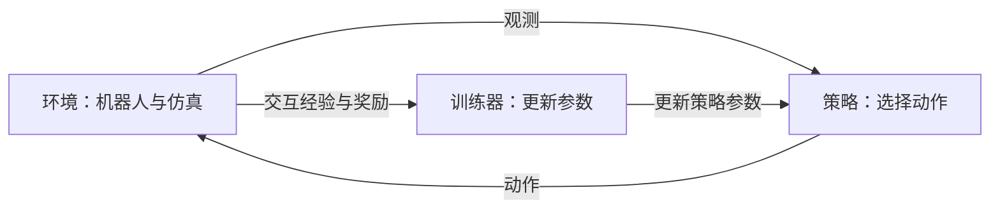

# 强化学习基础预习

本页是 Day1 前的入门读物。读完后，应能用站立实验解释智能体与环境如何交互，区分观测、动作、奖励和累计回报，并说明训练与评估各自做什么。PPO 和 GAE 的计算细节将在课堂讲解。

## 1. 强化学习在学习什么

强化学习让智能体与环境反复交互：观察当前情况，选择动作，看到动作带来的变化和奖励，再根据这些经验改进策略。目标是让未来的累计回报期望更高。

在本课中，机器人已有一个可训练的站立与行走策略。我们从同一个检查点开始续训，通过对照实验研究奖励改动如何影响站立表现，并检查行走和启停的副作用。

## 2. 智能体、环境与交互过程

| 概念 | 含义 | 本课中的例子 |
|---|---|---|
| 智能体（Agent） | 根据观测选择动作的决策者 | 学习并使用站立与行走策略的决策部分 |
| 环境（Environment） | 接收动作、推进运动，并返回新观测、奖励与回合结束信息 | 包含机器人模型、物理仿真、控制解码和奖励计算的训练环境 |
| 观测（Observation） | 智能体实际接收的信息 | 关节角、关节速度、IMU 相关量、速度指令及其历史等 |
| 动作（Action） | 智能体选择的控制输出 | 经缩放、滤波和控制解码后影响关节目标与运动的输出 |
| 奖励（Reward） | 环境按规则给出的单步行为评分 | 速度跟踪、姿态、支撑等奖励与站立速度惩罚的组合 |
| 策略（Policy） | 从观测到动作的决策规则，可以输出一个动作或动作分布 | 检查点中保存的 Actor 神经网络 |

一次交互包括：取得观测 → 策略选择动作 → 环境执行动作 → 得到新观测、奖励和结束信息。训练器收集多次交互的经验，用它们更新策略参数。



## 3. 状态与观测有什么区别

**状态**描述环境的完整情况，**观测**是策略实际能拿到的信息。仿真器可以知道机器人真实位置和真实速度，策略输入则由控制接口明确规定。

强化学习常用马尔可夫决策过程（MDP）描述环境：给定当前完整状态和动作，下一状态的概率分布不再依赖更早的历史。机器人策略往往只能获得部分信息，因此本课使用观测历史帮助决策。

本课 Actor 接收规定的传感器与指令历史；真实位置、真实速度和朝向误差可用于奖励、Critic 和评估，但不作为 Actor 输入。修改奖励时，应遵守这个输入接口。具体字段和模型形状见 [仓库与模型说明](repository_guide.md)。

## 4. 奖励、累计回报与折扣因子

奖励是一次交互的评分。累计回报（Return）把从当前时刻开始的一系列奖励合起来，常对更远的奖励使用折扣：

```text
G_t = r_t + gamma * r_(t+1) + gamma^2 * r_(t+2) + ...
```

`gamma`（γ）称为折扣因子，通常取 0 到 1 之间的值。它越接近 1，未来奖励在回报中保留的权重越大。

例如，两个选择各得到两步奖励，`gamma=0.9`：

| 选择 | 两步奖励 | 从第一步开始的回报 |
|---|---|---|
| A | `2, 0` | `2 + 0.9 × 0 = 2` |
| B | `0, 3` | `0 + 0.9 × 3 = 2.7` |

这是一个数字示例。B 的第一步奖励较低，但两步回报更高；学习时需要考虑动作的后续影响。

在站立实验中，提高站立速度惩罚会改变奖励对行为的评价。策略可能学到更稳的动作，也可能出现行走副作用，需要用同等条件的物理评估验证。B/C 使用不同奖励系数时，训练奖励数值的含义也随之变化，不能直接把数值更高当作运动表现更好。

## 5. 步、回合、采样与训练迭代

| 名称 | 含义 | 与本课配置的关系 |
|---|---|---|
| 一步（Step） | 执行一次动作并获取反馈 | 每个环境产生一次交互样本 |
| 回合（Episode） | 从初始化开始，到终止或达到时间限制的一段交互 | 结束后训练环境可以复位并开始下一回合；失败终止与时间限制需要分别记录 |
| 采样段（Rollout） | 为训练收集的一段连续交互经验 | `rollout_steps` 指定每个环境每次收集的步数，可以跨越多个回合 |
| 并行环境 | 同时采样的多个环境实例 | `num_envs` 指定数量 |
| 训练迭代（Iteration） | 收集一批经验，再进行一轮参数更新流程 | `iterations` 指定这样的流程重复多少次；一次迭代可包含多次优化器更新 |

当前 [baseline 配置](../configs/baseline.json) 使用 `num_envs=64`、`rollout_steps=256`、`iterations=20`，交互样本总量为 `64 × 256 × 20 = 327680`。改变环境数量、采样步数或迭代次数都会改变采样预算。

比较 B/C 时应保持这些条件一致。本课评估只统计首次物理回合：失败后复位产生的运动不能继续算作同一次成功站立。

## 6. 探索、策略与价值函数

训练时，智能体需要尝试不同动作，才能发现更好的行为，这称为**探索（Exploration）**。随机动作也可能产生较差结果，训练器会结合采样经验调整策略。

本课训练器使用固定标准差的高斯采样产生探索，采样结果再转换为有界的关节动作。评估与回放使用确定性的模型推理，并记录初始条件。模型输出确定并不代表所有实验结果相同：初始状态、指令和环境条件仍会影响运动。

**价值函数（Value Function）**估计在某种情况继续执行策略，未来能获得多少累计回报。本课 Actor 负责选择动作，Critic 负责估计价值并辅助学习；两者的输入信息和职责需要分别理解。

本课使用 PPO 更新策略，帮助控制一次更新的变化，降低策略改动过大的风险。课堂会进一步讲解 Critic、优势估计、GAE 和 PPO 如何配合完成更新。

## 7. 训练与评估分别回答什么问题

| 环节 | 主要工作 | 要回答的问题 |
|---|---|---|
| 训练 | 采样交互经验、计算学习目标、更新网络参数 | 策略如何根据经验改变？ |
| 评估 | 加载选定检查点，在规定条件下运行，保持模型参数固定并测量结果 | 当前策略实际站得怎样，行走和启停有没有副作用？ |
| 导出 | 将选定策略转为 ONNX，并检查推理数值一致性 | 转换后的模型是否保持约定接口与输出？ |

站立表现需要同时考虑水平速度、漂移、姿态、存活和保护触发情况。训练奖励、物理表现和导出数值一致性分别提供不同证据。

本课 A 是教学起点，B 是原配置续训，C 是只改变指定因素的续训。B/C 从同一个检查点开始，保持算法、预算和评估条件一致，才能分析指定改动的影响。完整流程见 [学生实验手册](student_lab.md)。

## 8. 课前自测

请先自己回答，再对照参考要点。

| 问题 | 参考要点 |
|---|---|
| 在站立实验中，谁选择动作，谁计算新观测与奖励？ | 策略选择动作；环境推进运动并返回反馈；训练器用经验更新参数。 |
| 仿真器知道的真实速度，是否就能直接添加到 Actor 输入？ | Actor 输入由控制接口规定；仿真奖励或 Critic 能使用的信息，需要与 Actor 观测分别核对。 |
| `gamma=0.9` 时，两步奖励 `1, 2` 的回报是多少？ | `1 + 0.9 × 2 = 2.8`。 |
| `rollout_steps=256` 是否表示一个回合一定持续 256 步？ | 它规定采样段长度；回合可以提前结束并复位，采样段也可以包含多个回合。 |
| 训练中采样随机动作有什么作用？评估时为什么固定模型参数？ | 采样支持探索；评估用于测量选定策略，固定参数才能明确测量对象。 |
| C 的训练奖励高于 B，能否据此判断 C 站得更稳？ | 还需要相同条件的物理评估；奖励系数变化会改变奖励数值的含义。 |

完成后回到 [课前准备清单](preclass_preparation.md)，记录仍不熟悉的概念与问题，带到课堂讨论。
